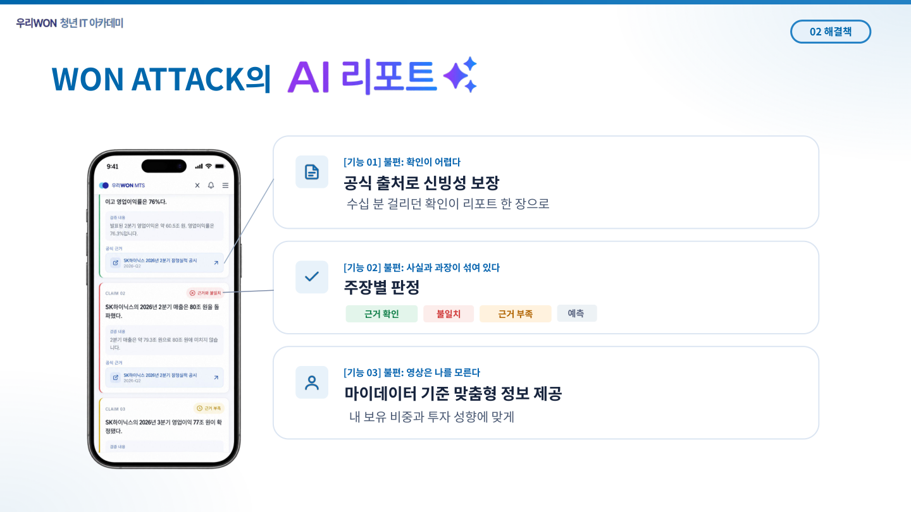
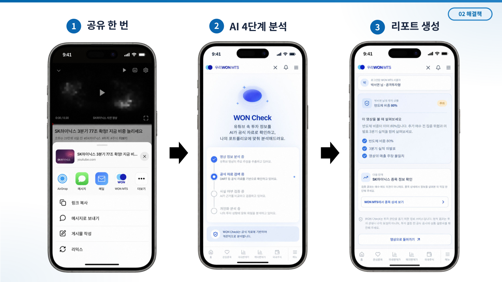

# WON ATTACK | AI 기반 투자 정보 검증 서비스

**최윤하 | Frontend Developer**

## 01. 프로젝트 소개

온라인 투자 정보의 신뢰성을 판단하기 어려운 투자자가 AI 분석 결과와 근거 정보를 확인할 수 있도록 웹 기반 프로토타입을 개발했습니다.

- **프로젝트:** AX 해커톤
- **기간:** 2박 3일
- **팀 구성:** 5명
- **구현 결과:** 웹 기반 프로토타입
- **개인 담당:** MTS 및 AI 분석 리포트 화면의 UI 설계·프론트엔드 구현

## 02. 기술 스택 및 활용

- **React:** MTS·분석 리포트 화면을 컴포넌트로 구성하고 사용자 인터랙션 구현
- **TypeScript:** 프론트엔드 구현에 사용
- **Vite:** 프론트엔드 프로젝트 개발 환경에 사용

화면 구성과 인터랙션 구현에 적합하다고 판단해 React를 사용했습니다. 분석 요청 후 로딩·결과 화면이 전환되도록 구현했습니다. 기본 시연 영상에는 Mock 데이터를 사용하며, 설정에 따라 실제 AI API 응답을 받아 결과를 표시할 수 있습니다.

## 03. 주요 구현 기능 및 개인 기여

### ① MTS 및 AI 분석 리포트 UI

- MTS와 분석 리포트 화면을 직접 설계하고 React 컴포넌트로 구현
- 투자 정보의 분석 결과와 근거 정보를 확인할 수 있는 리포트 화면 구성

### ② AI 분석 결과 화면 전환

- 분석 요청 후 로딩·결과 화면 전환 구현 (시연 영상은 기본 Mock 데이터, 실제 API 연결 지원)
- 사용자가 분석 결과를 화면에서 확인할 수 있도록 UI 연결

### ③ 단계별 가이드 및 Tooltip

- 발표 시연 흐름에 맞춘 단계별 안내 기능 구현
- 사용자 클릭에 따라 Tooltip 안내가 순차적으로 표시되도록 구현

### 구현 및 동작 확인

MTS·리포트 화면 표시, 분석 결과 화면 전환, Tooltip의 순차 표시, 화면 크기에 따른 레이아웃을 직접 확인했습니다. 테스트 기기·해상도 및 세부 검증 조건은 별도로 기록하지 않았습니다.

## 04. 프로젝트 결과 및 회고

### 프로젝트 결과

5인 팀에서 투자 정보 검증 서비스의 웹 프로토타입을 완성했습니다. 이 중 MTS·분석 리포트 UI 설계부터 React 컴포넌트 구현, 분석 결과 화면 전환 및 시연용 Tooltip 구현을 담당했습니다.

### 개발 과정에서 배운 점

- **화면 설계와 구현:** MTS·리포트 화면을 직접 설계한 뒤 컴포넌트로 구현하며 UI 구성과 인터랙션을 연결하는 경험을 쌓았습니다.
- **API 연동 화면:** 분석 요청과 결과 화면의 연결을 구현하고 동작을 확인했습니다. 시연 영상은 Mock 데이터를 사용하며 실제 API 연동 경로도 구현했습니다.
- **레이아웃:** 개발 중 화면 요소의 위치·정렬 문제를 경험하며 화면 표시와 배치의 중요성을 확인했습니다.

### 한계 및 개선 계획

2박 3일 동안 프로토타입 구현에 집중해 실사용자 검증과 성능 측정은 진행하지 못했습니다. 화면 요소의 위치·정렬 문제도 경험했지만 구체적인 해결 방법은 기록으로 확인되지 않습니다.

향후에는 화면 크기별 레이아웃을 정해진 테스트 조건에서 점검하고, API 응답 지연·오류 상황에 대한 안내 화면을 보완한 뒤 정상·오류 시나리오에서 결과를 확인하고자 합니다.

## 05. 관련 링크

- **GitHub 저장소:** https://github.com/won-attack/won-attack
- **프론트엔드 코드:** https://github.com/won-attack/won-attack/tree/main/frontend
